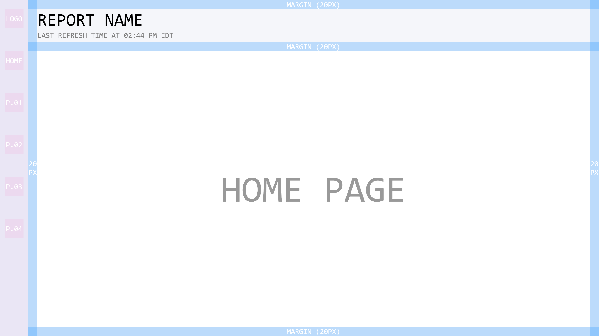

# Power BI Report Template

Every dashboard in my portfolio starts from this template. It sets the layout, navigation, spacing, and supporting tables up front, so each new report looks and works like the last one, and people only have to learn how to use my reports once.

I think of myself as a designer for data. Communication is measured by how it's received, so the goal is a report anyone outside of IT and analytics can understand at a glance. This template is where that starts.

## Layout

- **Canvas:** 1920 × 1080
- **Navigation panel (left):** logo, Home button, and page buttons (P.01–P.04). The panel stays in the same place on every page, so users always know how to get around.
- **Header:** report name and last refresh time, so viewers always know how current the data is.
- **Margins:** 20px on every side of the content area. The blue guides in the screenshot are layout aids that get removed once visuals are placed.

## Design system

| Element | Standard |
|---|---|
| Body / UI text | Segoe UI |
| Headers and numbers | Consolas (monospace keeps numbers aligned and easy to scan) |
| Font sizes | Multiples of 4px, 12px minimum (8px only for fine print) |
| Spacing and sizing | Multiples of 10px for margins, shapes, and containers |

## Built-in model tables

The template ships with three helper tables, so every report starts with the same foundation:

| Table | Purpose |
|---|---|
| `_Calendar` | Shared date table with display-ready columns (`MM.Name`, `YYYY-MM`, `MM/DD`, etc.) |
| `_Measures` | A single home for every measure, including the HTML measures that render custom cards and home pages |
| `_Refresh Display` | Powers the "Last refresh" line in the header, with time zone handling |

## Home page pattern

Every report built from this template opens on a home page instead of dropping people straight into charts. Each one includes:

- A plain-language summary of what the report tracks
- A one-line status that answers "are we okay?" (for example, *within target*), highlighted in green
- The data source and the date range the data covers
- The refresh schedule
- A brand panel identifying the source system

## Reports built on this template

| Report | Source system |
|---|---|
| [Healthcare Claims](https://github.com/franklinbusi/Epic-Healthcare-Claims) | Epic |
| [ERP Expenses](https://github.com/franklinbusi/NAV365-Enterprise-Resource-Planning-Expenses) | Microsoft Dynamics 365 Business Central |
| [Help Desk CSAT](https://github.com/franklinbusi/ManageEngine-Help-Desk-CSAT) | ManageEngine ServiceDesk Plus |
| [Network Infrastructure](https://github.com/franklinbusi/SolarWinds-Network-Monitor-Infrastructure) | SolarWinds Orion |

## How the data flows

Every report built on this template follows the same setup, which I configured end to end:

1. **Source systems:** each report connects directly to the SQL Server database behind the application named on its home page.
2. **Gateway:** an on-premises data gateway, which I installed and configured on a dedicated virtual machine, lets the Power BI service reach those on-premises databases securely.
3. **Scheduled refresh:** reports refresh automatically throughout business hours, so the numbers stay current without anyone running them by hand.
4. **Shared workspace:** finished reports are published to a shared workspace, giving every user the same up-to-date version.

## Tools

| Tool | What I use it for |
|---|---|
| Power BI Desktop | Report design, data modeling, Power Query |
| Power BI Service | Shared workspace, scheduled refresh, distribution |
| On-premises data gateway | Secure refresh from on-premises SQL Server, hosted on a VM |
| SQL Server | Source queries and views |
| Canva | Hand-designed navigation icons and custom HTML visual elements |
| Claude Code | AI-assisted development of DAX measures and SQL |
